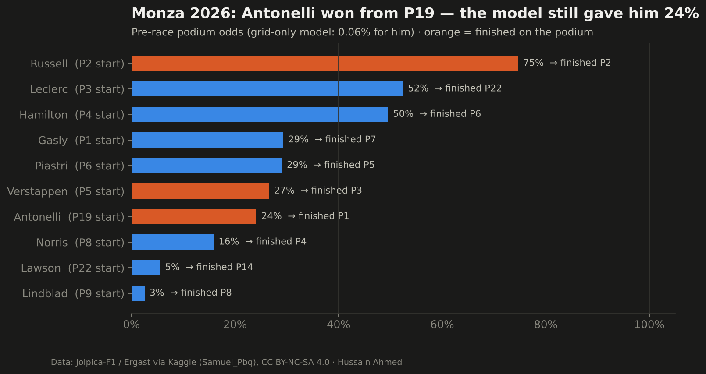
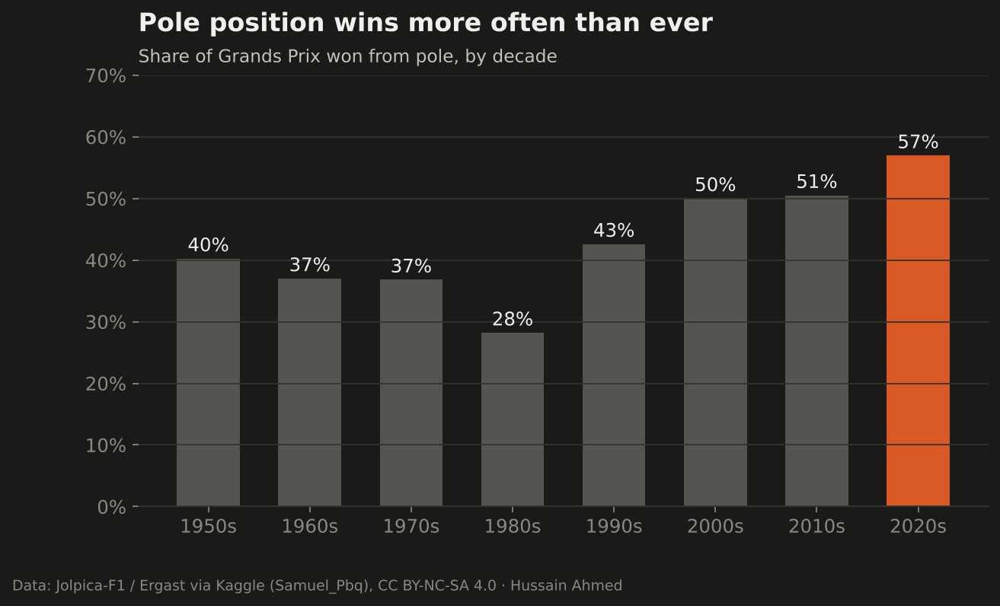
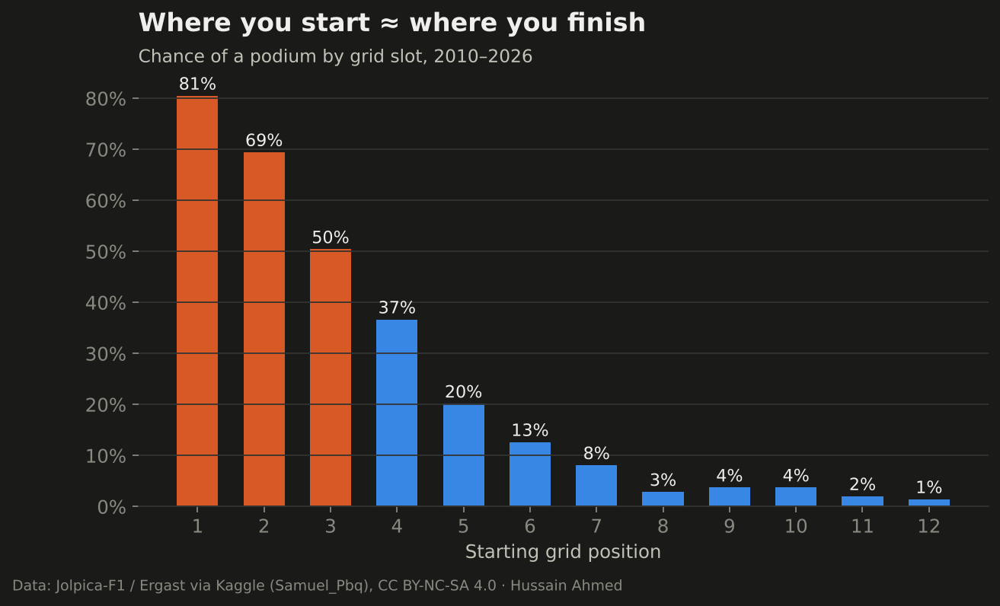
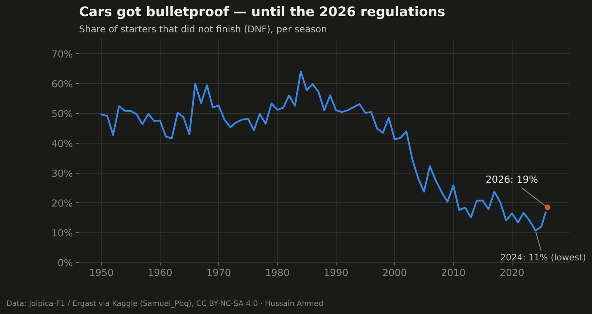
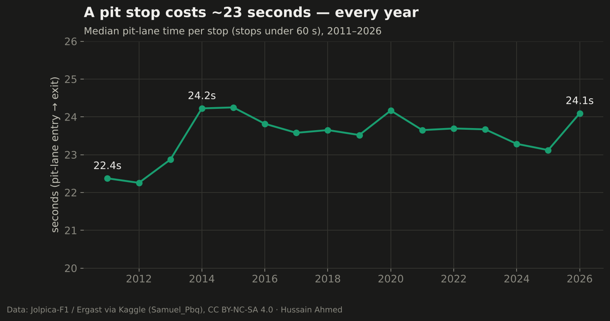
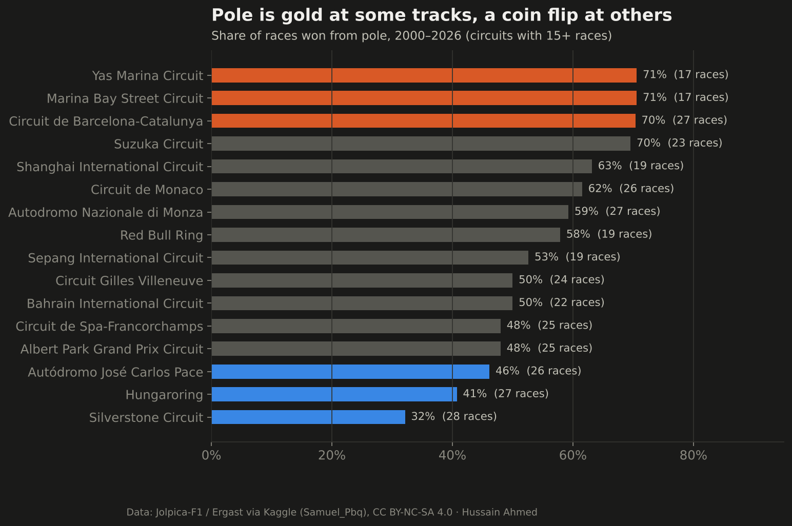
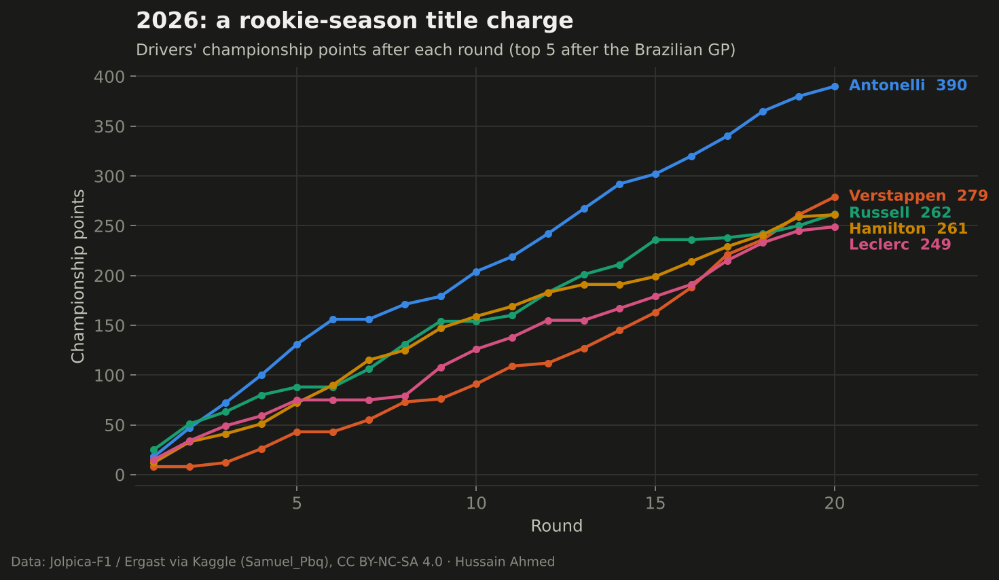
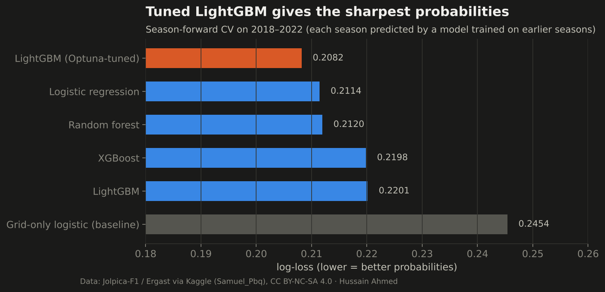
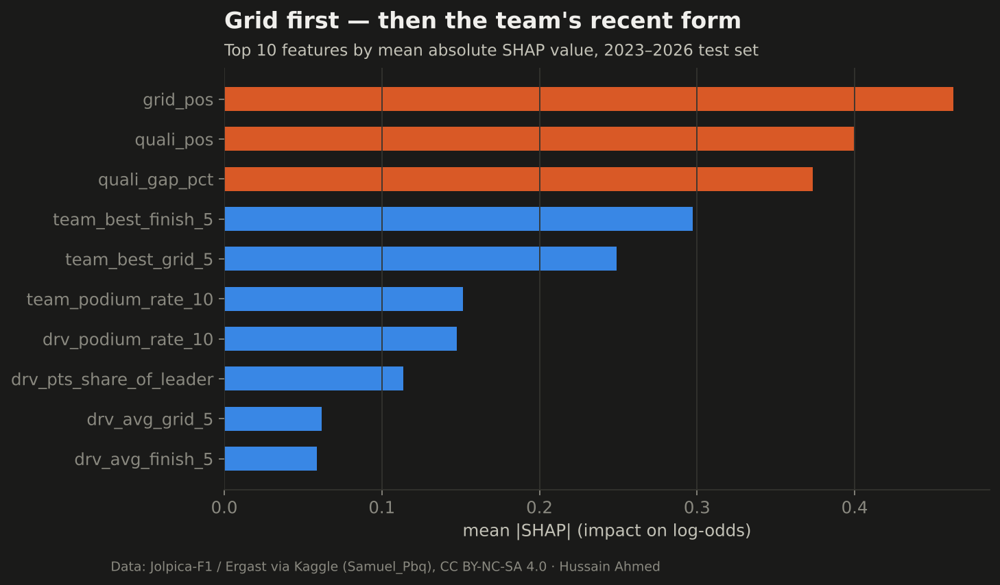
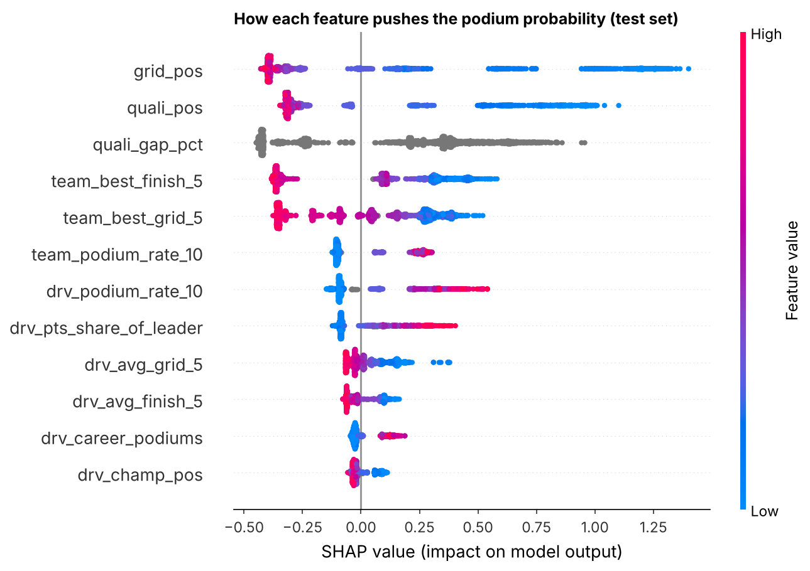

# 🏁 F1 Podium Predictor: 77 seasons of Formula 1, analysed and modelled

**Before the lights go out, what is each driver's chance of finishing on the podium?**

This project analyses every Formula 1 Grand Prix from **Silverstone 1950 to the Brazilian GP 2026** (1,169 races,
77 seasons). It then builds a **leak-free, tuned machine-learning model** that predicts podium probabilities from
information available before the race. Validation is done the way the sport works, season by season, and the model
is tested on **90 races from 2023–2026** that it never saw during training or tuning.

> Deliverables: a reproducible notebook, 11 publication-quality charts, an **interactive dashboard**
> (`reports/f1_dashboard.html`) and a **Streamlit app** with a race explorer and a what-if simulator.

---

## Headline results

| | Tuned LightGBM | Grid-only model |
|---|---|---|
| ROC-AUC | **0.943** | 0.919 |
| PR-AUC | **0.736** | 0.681 |
| Log-loss | **0.209** | 0.243 |
| Brier score | **0.0647** | 0.0692 |
| Race winner = model's top pick | **67.8%** | 61.1% (pole-sitter) |
| Podium finishers among the top-3 picks | 2.02 / 3 | 2.01 / 3 |

*Test set = all 90 races of 2023, 2024, 2025 and 2026 (up to Brazil).*

- Log-loss is **14% lower** than a model that only knows the grid slot. The probabilities are sharper and
  well calibrated (see `figures/08_calibration.png`).
- The model picks the race winner **67.8%** of the time. Simply betting on the pole-sitter gives 61.1%.
- **Honest limit:** for choosing the three podium finishers, the model ties the grid order (2.02 vs 2.01 per
  race). The starting grid is extremely informative in modern F1. The model's value is in calibrated
  probabilities and in spotting surprises the grid misses.
- Of the 32 podiums scored from P6 or lower in 2023–2026, the model rated **84%** of those drivers higher than the
  grid-only model did.

**Case study: Monza 2026.** Antonelli started **P19** and won. A grid-only model gave him **0.06%**. This model
gave him **24%** because it knew Mercedes' recent form and his championship lead. Pole-sitter Gasly (Alpine)
got only 29% from the model (grid-only model: 71%), and he finished P7.



---

## 7 stories from the analysis

| # | Finding |
|---|---|
| 1 | **Pole is worth more than ever.** Pole-to-win conversion went from 28% in the 1980s to **57%** in the 2020s. |
| 2 | **Where you start ≈ where you finish.** Since 2010: P1 → 81% podium chance, P3 → 50%, P5 → 20%, P8 → 3%. |
| 3 | **Comebacks are rare.** Furthest-back winners: Watson 1983 (P22), Vukovich 1954 (P19), **Antonelli, Monza 2026 (P19)**. |
| 4 | **Cars got bulletproof, until 2026.** DNF rate fell from ~50% before 2000 to **11% in 2024** (lowest). The new 2026 rules pushed it back to **19%**. |
| 5 | **A pit stop still costs ~23 s.** The median pit-lane time has stayed between 22.3 and 24.3 s every season since 2011. |
| 6 | **Pole is gold at some tracks, a coin flip at others.** Since 2000, pole won 71% of races at Yas Marina and Marina Bay but only 32% at Silverstone. |
| 7 | **Dominance.** Red Bull 2023 won **21 of 22** races (95%), the most dominant season ever. 2026 so far: Antonelli 390 pts, Verstappen 279, Russell 262. |

| | |
|---|---|
|  |  |
|  |  |
|  |  |

---

## Method

### Data
[Formula 1 World Championship (1950 - 2026)](https://www.kaggle.com/datasets/samuelpombourcq/formula-1-world-championship-1950-2026) by **Samuel_Pbq** on Kaggle: Jolpica-F1, the
successor of the Ergast API. Classic Ergast layout with 15 tables, up to 2026 round 20.
**License: CC BY-NC-SA 4.0** (attribution, non-commercial, share-alike).

**Classification rule:** a driver is *classified* if their status is `Finished`, `Lapped` or `+N Laps`.
`Did not start / Withdrew / DNQ` rows are removed. Everything else is a **DNF**.

### Features: 27, all known before the start (`src/features.py`)
| Group | Features |
|---|---|
| Saturday | grid slot, qualifying position, % gap to pole, reached Q3, gap to team-mate on the grid, pit-lane start |
| Driver form (last 5/10 races) | avg finish, podium / win / DNF rate, avg grid, places gained, experience, career podiums |
| Team form (last 5/10 races) | best finish, best grid, podium rate, DNF rate |
| Championship | driver & team position and points share **after the previous round** |
| Circuit | driver's past results at this circuit, how much the grid usually reshuffles there |
| Context | sprint weekend, stage of the season, field size |

**Leakage control:** every rolling statistic uses `shift(1)`, so a race never sees its own result. Standings are
taken from the previous round, and circuit statistics only use earlier visits.
`tests/test_no_leakage.py` checks this: the 2024 features are identical whether or not 2025–2026 exist in the data.

### Validation & tuning
- **Season-forward CV:** for each season 2018–2022, train on every earlier season (from 2006) and predict that season.
- Compared: grid-only logistic baseline, logistic regression, random forest, XGBoost, LightGBM.
- **Optuna** (40 trials, TPE) tuned LightGBM on CV log-loss. It chose a small, strongly regularised model: 4 leaves,
  ≥129 rows per leaf, learning rate 0.0066, 750 trees.

| Model (CV 2018–2022) | ROC-AUC | PR-AUC | Log-loss | Brier |
|---|---|---|---|---|
| **LightGBM (Optuna-tuned)** | **0.942** | **0.717** | **0.208** | **0.0649** |
| Logistic regression | 0.939 | 0.710 | 0.211 | 0.0662 |
| Random forest | 0.939 | 0.702 | 0.212 | 0.0657 |
| XGBoost (default) | 0.937 | 0.684 | 0.220 | 0.0689 |
| LightGBM (default) | 0.938 | 0.693 | 0.220 | 0.0682 |
| Grid-only logistic (baseline) | 0.918 | 0.659 | 0.245 | 0.0718 |



### What drives a podium? (SHAP, test set)
Grid slot, qualifying position and gap to pole come first. **The team's recent form** comes next: best finish and
best grid over the last 5 races, and podium rate over the last 10. After that come the driver's own podium rate and
his championship points share.

| | |
|---|---|
|  |  |

---

## Run it in VS Code

```bash
# 1. create an environment (once)
python -m venv .venv
.venv\Scripts\activate            # Windows  (macOS/Linux: source .venv/bin/activate)
pip install -r requirements.txt

# 2. open notebooks/f1_podium_predictor.ipynb and "Run All"  (~2 min, Optuna included)

# 3. interactive dashboard: open reports/f1_dashboard.html in any browser
python src/make_dashboard.py      # rebuilds a fully offline copy (the repo copy loads Plotly from a CDN)

# 4. Streamlit app
streamlit run app/streamlit_app.py
```
VS Code shortcuts: rename the folder `vscode_config` to `.vscode`. Then **Terminal → Run Task** has the 4 steps above,
and **Run and Debug** has *Streamlit app*.

## Repo structure
```
├── data/raw/                 Ergast-format CSVs (CC BY-NC-SA 4.0); lap_times.csv (18 MB, not used by the model)
│                             is not in the repo: download it from Kaggle if you need it
├── data/model_table.csv      feature table written by the notebook
├── notebooks/f1_podium_predictor.ipynb   analysis → features → CV → Optuna → test → SHAP
├── notebooks/f1_podium_predictor_kaggle.ipynb   self-contained version for Kaggle
├── src/
│   ├── features.py           leak-free feature engineering
│   ├── modeling.py           models, season-forward CV, race-level metrics
│   ├── style.py              one dark visual style for every chart
│   └── make_dashboard.py     builds reports/f1_dashboard.html (Plotly)
├── app/streamlit_app.py      race explorer + what-if simulator
├── models/podium_lgbm.joblib tuned model retrained on 2006–2026 (for the app)
├── results/                  metrics.json (every reported number) + test_predictions.csv
├── figures/                  11 charts
├── reports/f1_dashboard.html interactive dashboard
└── tests/test_no_leakage.py  proves the features ignore future races
```

## Limitations
- This is a pre-race model. It cannot foresee crashes, safety cars, rain or strategy calls.
- 2026 is a new regulation era. The model learns the new order only through rolling form, race by race.
- Qualifying data for 1994–2002 is incomplete in the source, so modelling starts in 2006.
- Ideas for next steps: practice-session pace (2025–26 only), weather, and a Monte-Carlo championship simulation.

---
**Hussain Ahmed**, Computer Science graduate (2025), Data & Machine Learning ·
Python · Pandas · scikit-learn · LightGBM · XGBoost · Optuna · SHAP · Plotly · Streamlit

*Non-commercial portfolio project. Not affiliated with Formula 1, the FIA or any team.*
